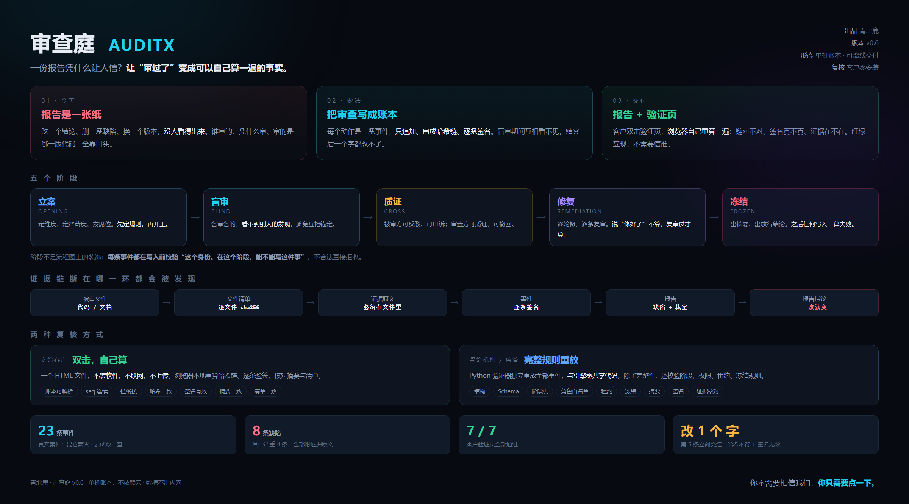

# Comet815

> Qinghai · Qingbei Deer Studio · Shipping AI on-prem: local deployment, review verification, production pipelines

[中文](README.md) · **English**

I do one kind of work: put AI into other people's machines — and prove it did the job right.

Not API demos. Models, hardware, process, and an evidence chain, put together into something deliverable.

---

## Now

- Enterprise mentor at Qinghai Minzu University
- Led a team to a provincial competition award; next stop is the national competition
- Local model deployment runs on Mac mini and Windows / Linux Mini PCs (N100 / 8845HS and similar) — it only counts if it actually runs

---

## Two projects

### [AuditX Verifier](https://github.com/Comet815/auditx-verifier) · The Courtroom

**Don't trust me. Verify it yourself.**

An independent verifier for append-only review ledgers: hash chain + per-event Ed25519 signatures + a manifest of reviewed files + evidence text checks.
A client double-clicks one HTML file and the browser re-computes everything locally — no network, no Python install.

`Python` `JavaScript` `Cryptography` `Zero dependencies`

**[▶ Live demo](https://comet815.github.io/auditx-verifier/)** — open it and verify: green is the original ledger, red is the same ledger with one word changed.

**Where it fits:**

- Software acceptance for organizations: the deliverable is not a Word doc, but a ledger anyone can re-compute
- Code review: defects, remediation conditions, and conclusions are all on the record — changes can be caught
- Deliverables that need to stand up externally: who reviewed it, which version, and whether it was altered can all be verified

### [Hummingbird](https://github.com/Comet815/hummingbird)

**Spend on judgment where it's expensive; spend on execution where it's cheap.**

A one-person AI production pipeline: standards set in the cloud, work done locally, machine gates, and a different role for final review.
Code is not public. The method is.

📄 **[Full method → METHOD.md](https://github.com/Comet815/hummingbird/blob/main/METHOD.md)**

`Method` `LLM Pipeline` `Cost Engineering`

Measured: local writer 26.8 tok/s, gate tests 11/11 passed on the first run, cloud cost a few cents per run.

---

## In progress

- An independent side-scrolling action platformer (in development — to be added here later)

---

## What I'm doing

- Local model deployment (on Mac mini and Windows / Linux Mini PCs — it only counts if it actually runs)
- Software acceptance and code review for organizations, with verifiable reports
- Turning "review" from a Word doc into a ledger anyone can re-compute

## How to work together

**Two kinds of engagements:**

1. **Local model deployment** — on Mac mini and Windows / Linux Mini PCs; it only counts if it actually runs
2. **Software acceptance and code review** — verifiable reports, not just a Word doc

**Process:**

1. Talk through requirements and the machine environment
2. Agree on acceptance criteria before work starts
3. Deploy / review locally, with a trace of the process
4. Deliver the report plus an independently verifiable ledger the client can re-compute

Timeline and pricing depend on the project — talk through the requirements first.

## Tech stack

Python · JavaScript · Ed25519 · JSONL hash chains · llama.cpp / local inference · Windows industrial environments

## Also available for development

JavaScript · PHP · Web development

---

## Contact

- Email: joe09598375@gmail.com
- WeChat: tk1264

---

*Qingbei Deer · Qinghai*
