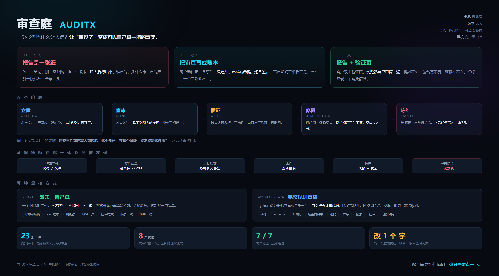

# Comet815

> 青海 · 青北鹿工作室 · 做 AI 落地：本地部署、审查验证、生产流水线

我做的是"把 AI 装进别人的机器里，并且证明它干得对"这一类活。

不是调 API 写 demo，是把模型、硬件、流程和证据链凑成一个能交付的东西。

---

## 两个项目

### [AuditX Verifier](https://github.com/Comet815/auditx-verifier) · 审查庭

**别信我，自己算。**

审查账本的独立复核器：哈希链 + 逐条 Ed25519 签名 + 被审文件清单 + 证据原文核对。
客户双击一个 HTML，浏览器本地重算一遍，不联网、不装 Python。

`Python` `JavaScript` `Cryptography` `零依赖`

**[▶ 在线演示](https://comet815.github.io/auditx-verifier/)** —— 点开就能验，绿的是原始账本，红的是被改了一个词的。

### [Hummingbird](https://github.com/Comet815/hummingbird) · 蜂鸟

**贵的地方只花在判断上，便宜的地方用来干活。**

一个人用的 AI 生产流水线方法：云上定标准，本地干活，机器门禁，换角色验收。
代码不公开，方法公开。

`Method` `LLM Pipeline` `Cost Engineering`

---

## 在做的事

- 本地模型部署（N100 / Mac mini 一类的机器上，跑得动才算数）
- 给单位做软件验收与代码审查，出可复核的报告
- 把"审查"这件事从一份 Word 变成一条能自己算的账本

## 技术栈

Python · JavaScript · Ed25519 · JSONL 哈希链 · llama.cpp / 本地推理 · Windows 工控环境

---

*青北鹿 · 青海*
